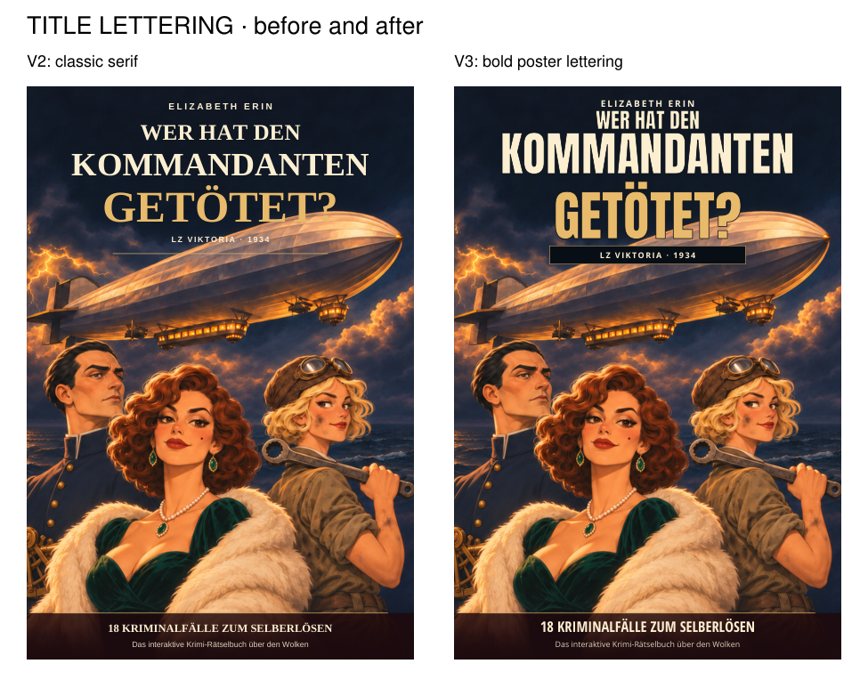
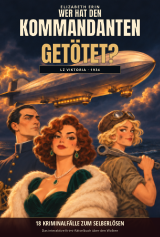
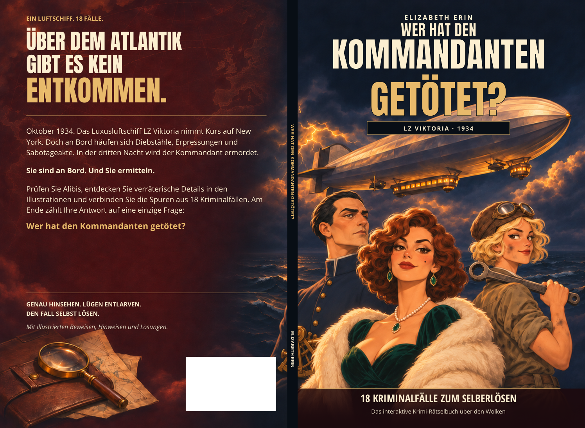

# Cover v3 — bold, readable lettering

**Wer hat den Kommandanten getötet? · Elizabeth Erin**

[Download the updated cover PDF](Wer_hat_den_Kommandanten_getoetet_Cover_KDP_FINAL_v3.pdf) — open the file and click **Download raw file**.

The title now uses **Anton**, a heavy condensed poster typeface. Taller, bolder letters keep the long word “KOMMANDANTEN” readable, and the large gold “GETÖTET?” supplies the focal point. A thin dark edge keeps the title clear where it meets the silver airship. The back blurb uses **Open Sans** for comfortable reading. The author, German wording and v2 character illustration are preserved.

## Before and after

## The front at a small bookstore-thumbnail size

## Complete cover

[Front](proofs/Cover_Front_FINAL.png) · [Back](proofs/Cover_Back_FINAL.png) · [Independent PDF renderer preview](proofs/Cover_Poppler_FINAL.png)

## Print file

Use the **single-page wraparound PDF** for the KDP paperback cover upload. It contains the back on the left, spine in the middle and front on the right. The interior remains the separate corrected v10 PDF.

| Setting | Value |
| --- | --- |
| Printing | Amazon KDP paperback, standard colour, white paper |
| Interior | 104 pages; 6.25 × 9.25 in trim |
| Spine | 0.234208 in / 5.9488832 mm |
| Full cover, with 0.125 in outside bleed | 12.984208 × 9.5 in / 329.7988832 × 241.3 mm |
| Background export | 3896 × 2850 px, 300 ppi at full size |
| Lettering | Live vector text, embedded fonts, German glyphs checked |

The blank white rectangle on the back is reserved for KDP's real barcode. No invented ISBN or fake barcode is included. Transparency is flattened, the background fills all bleed edges, and the print PDF has no guide labels or crop marks.

As previously disclosed and authorized, the unchanged v2 background is conventionally upscaled from 1466 × 1073 px (approximately 113 ppi). Upscaling does not create original image detail. All lettering remains sharp vector text.

The production checks and hashes are in [production-verification.json](production-verification.json). The authorization record quotes the user's typography request. The title typeface's source and SIL Open Font License are provided in `fonts/`. Previous covers and the interior are preserved.
