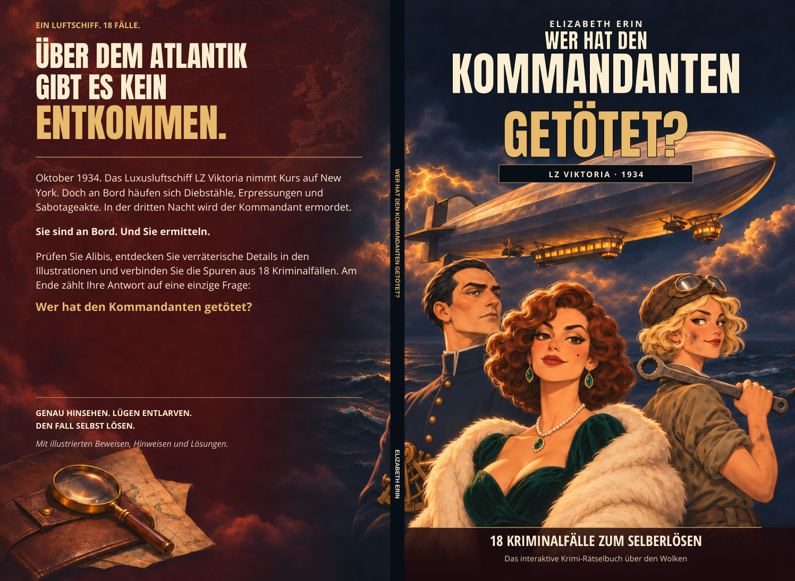

# Cover v4 — white barcode placeholder removed

**Wer hat den Kommandanten getötet? · Elizabeth Erin**

[Download the updated cover PDF](Wer_hat_den_Kommandanten_getoetet_Cover_KDP_FINAL_v4.pdf) — open the file page and click **Download raw file**.

The white rectangle on the back cover has been removed. The original artwork fills that area, and Amazon can place its own barcode during printing.

[Back cover](proofs/Cover_Back_FINAL.png) · [Front cover](proofs/Cover_Front_FINAL.png)

The v3 typography, wording, characters, spine and print dimensions are preserved. A pixel comparison confirms that only the old white rectangle area changed. No new artwork was generated and the interior was not edited.

This is one wraparound PDF for **KDP paperback, standard colour on white paper**, matching **104 interior pages at 6.25 × 9.25 in**. The spine is **0.234208 in / 5.9488832 mm**, and the full cover with outside bleed is **12.984208 × 9.5 in / 329.7988832 × 241.3 mm**.

The background remains the previously disclosed conventional 300-ppi upscale of the original artwork. All lettering remains live vector text with embedded fonts. Transparency is flattened and all bleed edges are filled.

Production checks are in [production-verification.json](production-verification.json). The source change deletes the native PDF rectangle to reveal the original illustration, without painting or regenerating it. Earlier covers remain available on their existing branches.
