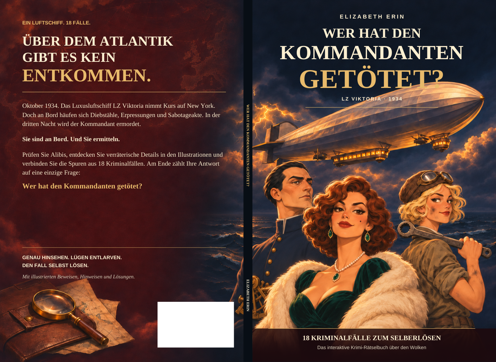

# Cover v2 — the principal characters

**Wer hat den Kommandanten getötet? · Elizabeth Erin**

This revised cover replaces the v1 cast with the principal characters shown on page 6 of the interior:

- **Operndiva Clara Bellini:** copper-red curls, emerald evening gown and ivory stole.
- **Bordingenieurin Lotte Lindner:** blonde waves, aviator cap, goggles and mechanic's spanner.
- **Erster Offizier Viktor Krantz:** sleek black hair and a navy high-collared uniform.

Their established designs are preserved in the book's warm painterly style. The change gives the cover a glamorous lead, varied silhouettes and stronger expressions. The title, author, German back blurb and print dimensions are retained. The cast does not identify the murderer.

[Front cover](proofs/Cover_Front_REVIEW.png) · [Back cover](proofs/Cover_Back_REVIEW.png) · [Before and after](proofs/Casting_Before_After_REVIEW.png)

[Download the v2 review PDF](Wer_hat_den_Kommandanten_Cover_REVIEW_v2.pdf) — open the file page and click **Download raw file**.

## Print setup

KDP paperback, standard colour on white paper; **104 interior pages**; **6.25 × 9.25 in trim**. The spine is **0.234208 in / 5.9488832 mm**. The full cover, including outside bleed, is **12.984208 × 9.5 in / 329.7988832 × 241.3 mm**. The blank white rectangle is reserved for KDP's barcode.

This is the **v2 design review**, pending approval of the new artwork. The original generated image has lower native resolution than the 300-dpi print target; the previously disclosed conventional print resizing will be applied after the design is accepted. The v1 files and all interior files are preserved.

Exact measurements and hashes are in `cover-specifications.json`. Character references are in `references/principal_cast_0.png` (unaltered image from interior page 6). No interior pages have been edited.
