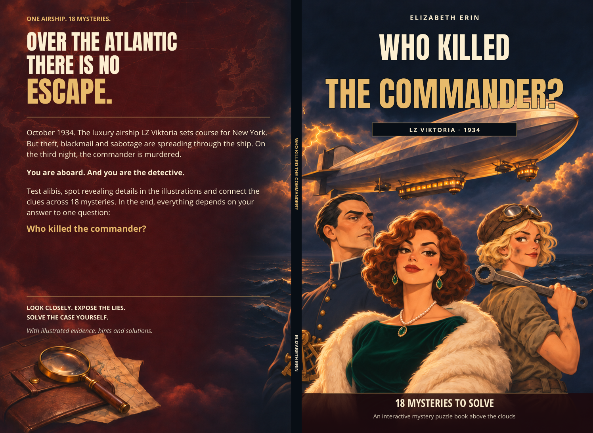

# Who Killed the Commander? — English edition

Author: **Elizabeth Erin**

- [Download the English interior](Who_Killed_the_Commander_English_Interior.pdf)
- [Download the matching English cover](Who_Killed_the_Commander_English_Cover.pdf)

Open each PDF file page and click **Download raw file**. Upload the interior and cover separately in KDP.

The English edition includes the story, all18 cases, detective notebooks, clues, hints, solutions, finale, certificate, illustration captions and printed evidence text. Fictional proper names and evidence codes are retained. Historical typewriter keyboard glyphs are retained as physical evidence; they are not untranslated prose.

Clara Bellini has a higher emerald neckline on the cover and both of her interior appearances (pages6 and81). Her face and other characters and clues are preserved.

Print setup: **104 pages**, **6.25 ×9.25 inch trim**, **KDP paperback, standard colour, white paper**. Matching spine **0.234208in /5.9488832mm**; full cover with bleed **12.984208 ×9.5in**. Amazon adds its own barcode; no white placeholder is drawn.

The cover background uses the previously disclosed conventional300ppi upscale; this does not create original painted detail. Lettering remains vector text with embedded fonts. Earlier German files are preserved.

The manuscript text and illustration-label map are provided for reference and future edits. They are recovered/translated production materials, not the original German source masters.
