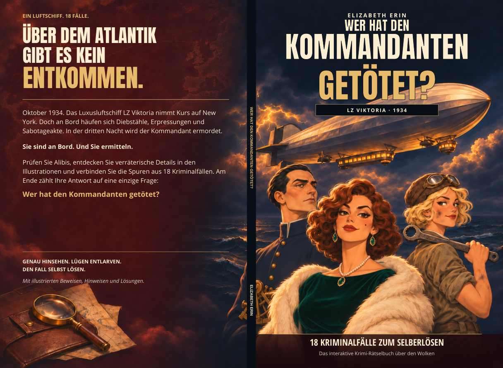

# Deutsche Ausgabe — Clara mit höherem Ausschnitt

Die einzigen Änderungen betreffen Claras Kleid: auf dem Cover sowie auf den Innenseiten6 und81. Es sind dieselben höheren Ausschnitte wie in der englischen Ausgabe. Alle deutschen Texte, die übrigen Illustrationen, Seitenverweise, Schriftarten und Layouts wurden beibehalten.

- [Deutscher Innenteil —104 Seiten](Wer_hat_den_Kommandanten_getoetet_Corrected_v11.pdf)
- [Deutsches Cover](Wer_hat_den_Kommandanten_getoetet_Cover_KDP_FINAL_v5.pdf)

PDF öffnen und **Download raw file** anklicken.

Format:6.25 ×9.25Zoll;104Seiten; KDP-Taschenbuch, Standardfarbe, weißes Papier. Buchrücken5.9488832mm. KomplettesCover mitBeschnitt329.7988832 ×241.3mm. KeinweißerBarcode-Platzhalter. Amazon fügt denBarcode hinzu.

Die älteren PDFs bleiben erhalten. Der Bildhintergrund entspricht weiterhin der bereits offengelegten300ppi-Hochskalierung; die Schrift bleibtVektortext.

