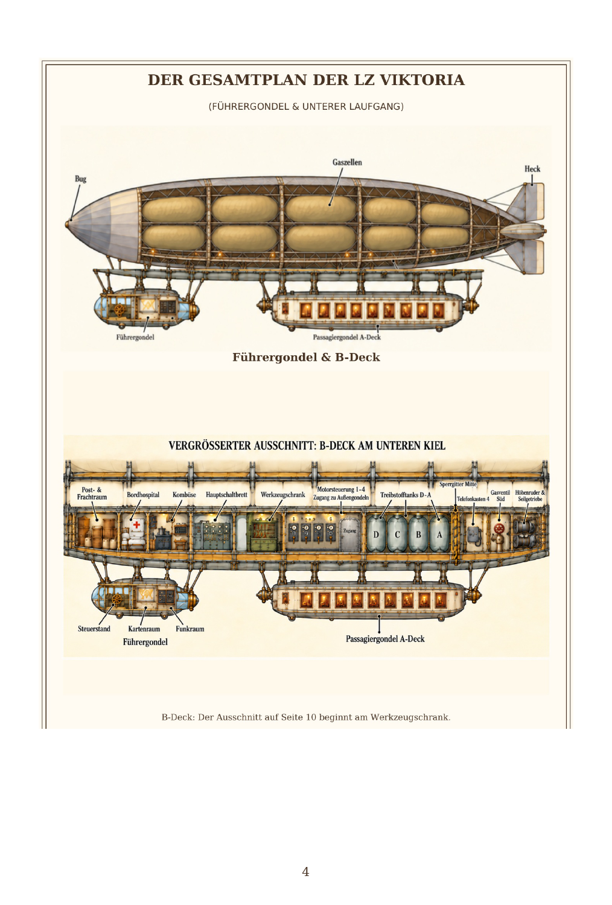
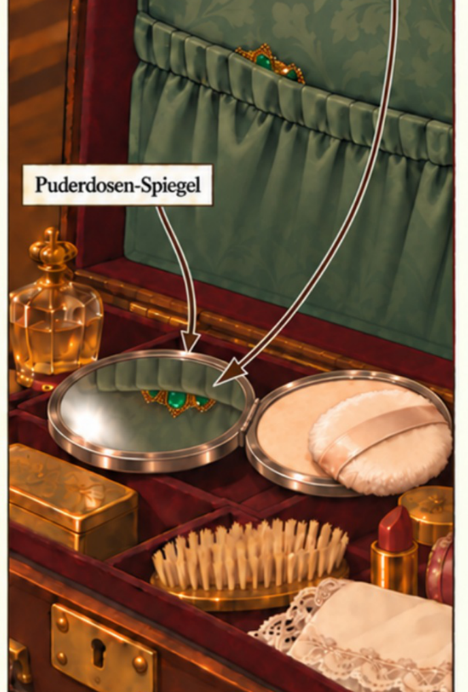
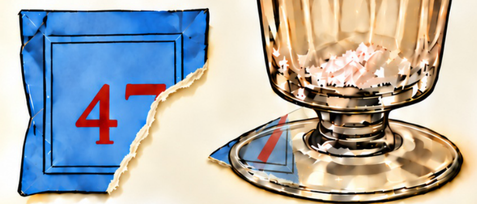
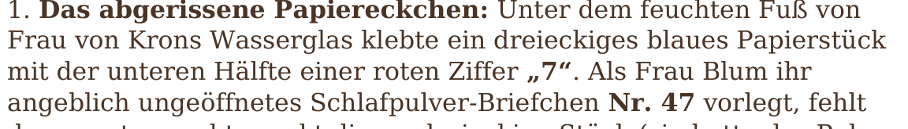

# v10 — page verification and delivery

Download **Wer_hat_den_Kommandanten_getoetet_Corrected_v10.pdf** from this branch using **Download raw file**.

This is a new export of the latest edited v9, with the existing 104 pages and 450 × 666 pt trim preserved. Previous PDFs are retained.

| Request | Result in v10 |
| --- | --- |
| Page 4 blueprint | Re-embedded the complete two-part image directly from v3 as a lossless DeviceRGB image, retaining all original decoded pixels and the D–C–B–A tanks. Confirmed visible with MuPDF and Poppler. The inspected v9 also rendered the image; this export makes the image encoding explicit. |
| Page 14 necklace | Kept the v9 restoration exactly, following the user's clarification: “Keep the v9 restoration.” The necklace edge and mirror reflection remain visible. |
| Page 36 torn 7 | The rendered illustration already shows the lower diagonal stroke removed from Briefchen 47 and present on the separate scrap under the glass. Preserved the matching evidence without an additional art change. |
| Page 35 corner | Explicitly covered the tiny top-left area above the header with white. The inspected v9 corner was also clear. |
| Page 94 sentence | Verified the visible and searchable text: `mit der unteren Hälfte einer roten Ziffer „7“. Als Frau Blum`. No raw LaTeX remains. |
| German quotes and umlauts | Verified all 47 specified phrases with three PDF text readers (141 checks). No requested phrases are missing. No straight double-quote or known broken-umlaut/LaTeX patterns were found. Existing correct text is preserved. |

All native text is unchanged from v9. Pages other than page 4 render pixel-identically to v9 with MuPDF; page 4 uses identical decoded v3 image pixels with lossless encoding. The page 5 layout and pages 101–104 remain intact. No new artwork was generated.

The machine-readable checks are in [verification_v10.json](verification_v10.json). The reproducible export script is [build_v10.py](build_v10.py).

## Page 4 — independent Poppler render

## Page 14 — restored necklace and reflection preserved

## Page 36 — torn digit and matching scrap

## Page 94 — literal German quotes, no LaTeX

## Full-page renders

[Page 4](v10_page_004.png) · [Page 14](v10_page_014.png) · [Page 35](v10_page_035.png) · [Page 36](v10_page_036.png) · [Page 94](v10_page_094.png)
