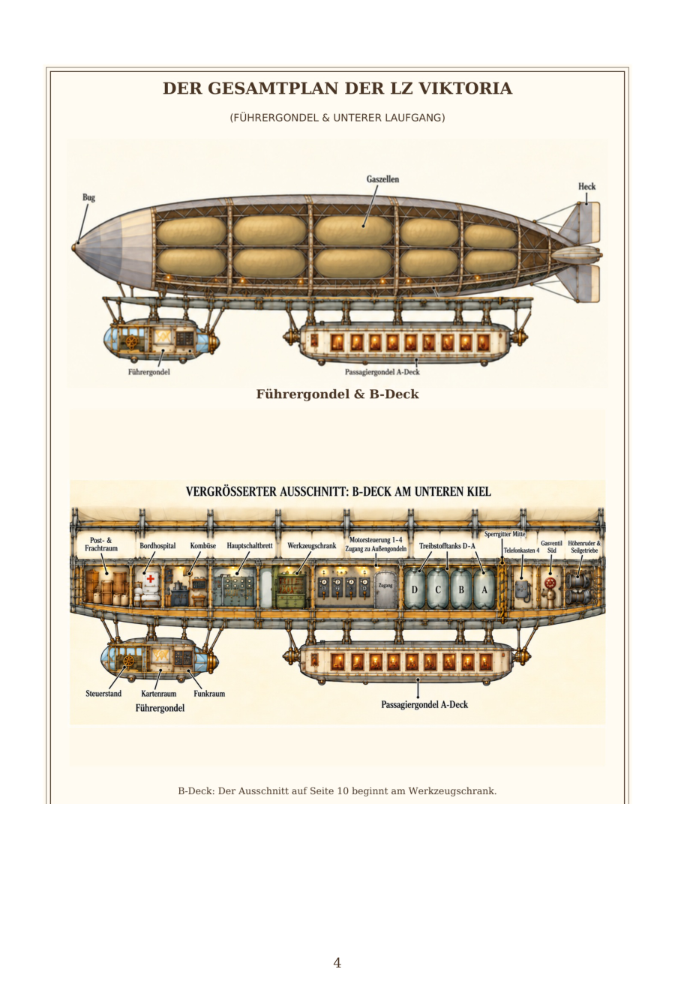
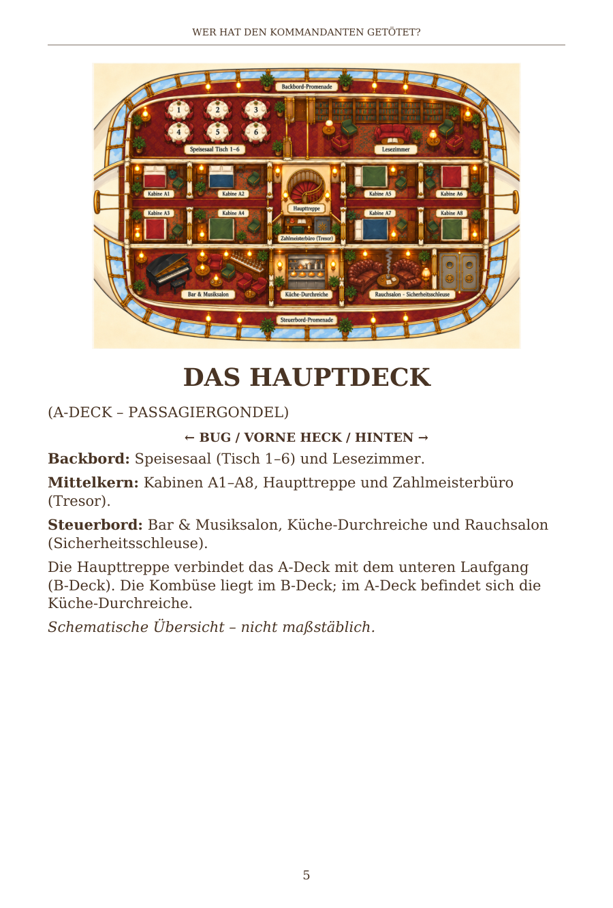
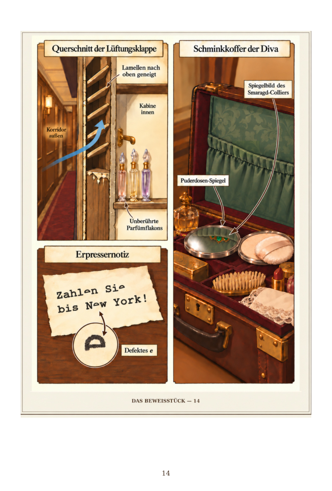
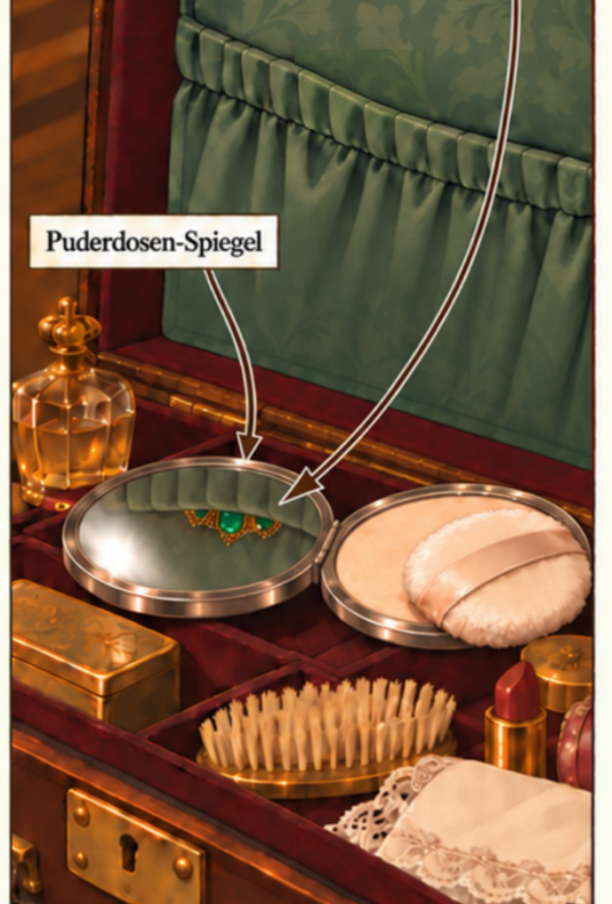
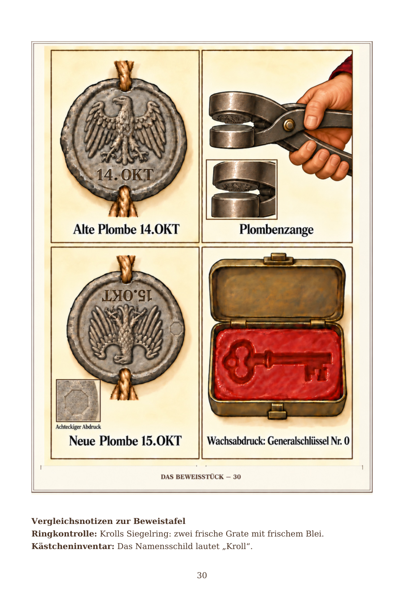
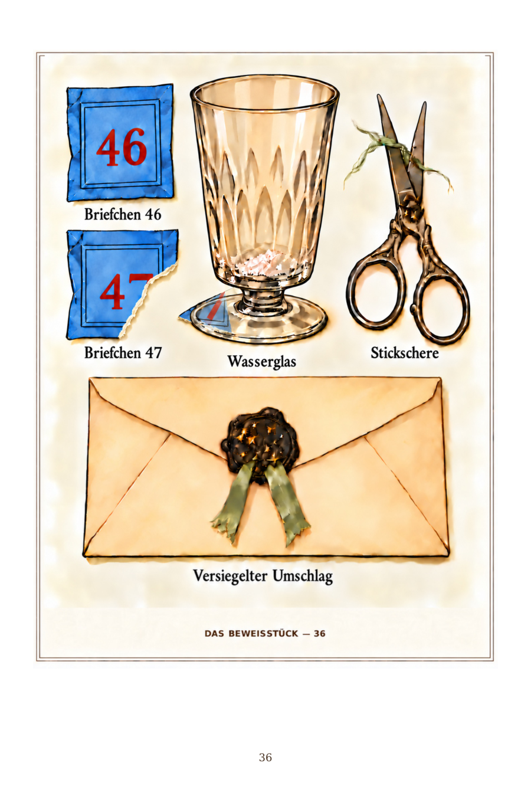
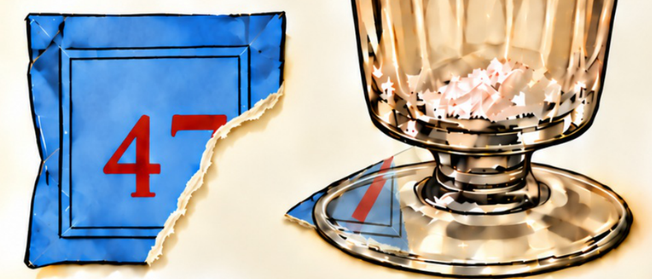

# V7 image proofs

These PNGs are rendered directly from the final v7 PDF.

[Open the v7 PDF](Wer_hat_den_Kommandanten_getoetet_Corrected_v7.pdf) and click Download raw file.

PDF SHA-256: `9210f657a1ab444df3138b4f802d70d93a23607f6f1210b1920e8dc47f827ab6`

## Page 4

Full two-part blueprint restored from v3, including fuel tanks D-C-B-A.

## Page 5

Approved room arrangement: Bug left, Heck right; dining/reading above the cabins and bar/kitchen/smoking below.

## Page 14

The necklace is concealed behind the green pocket and visible in the compact reflection.

## Page 30

All four evidence panels are visible, with extra margins.

## Page 36

The tear removes the lower diagonal stem of the red 7; the matching stem is on the scrap under the glass.

All 104 pages are retained. The other 99 pages are pixel-identical to v6. All 43 v6 text checks still pass in two independent readers and the valid Unicode maps are unchanged.
