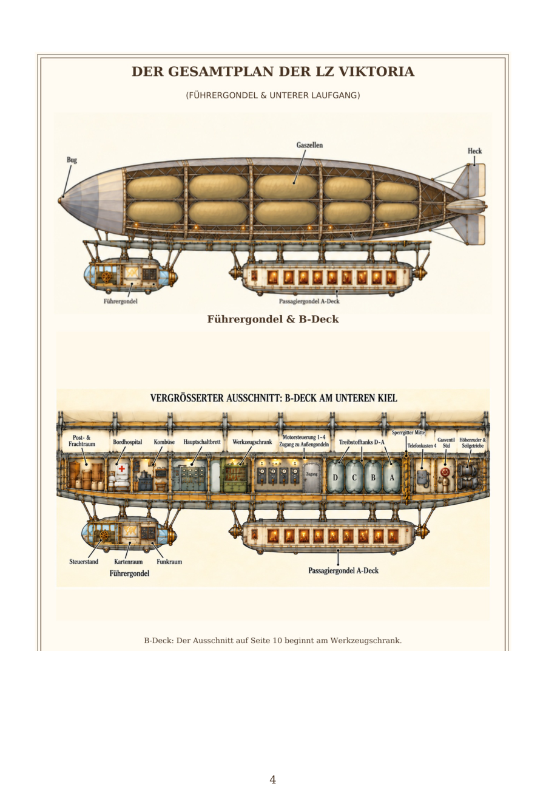
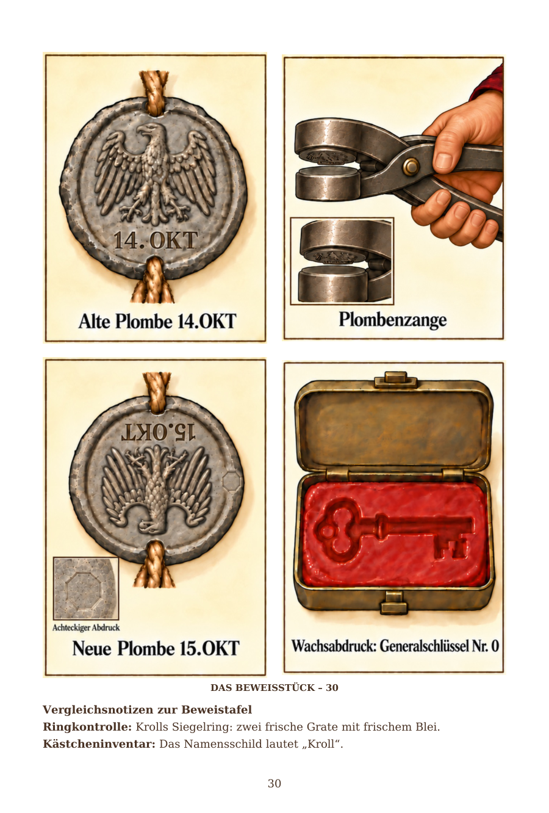
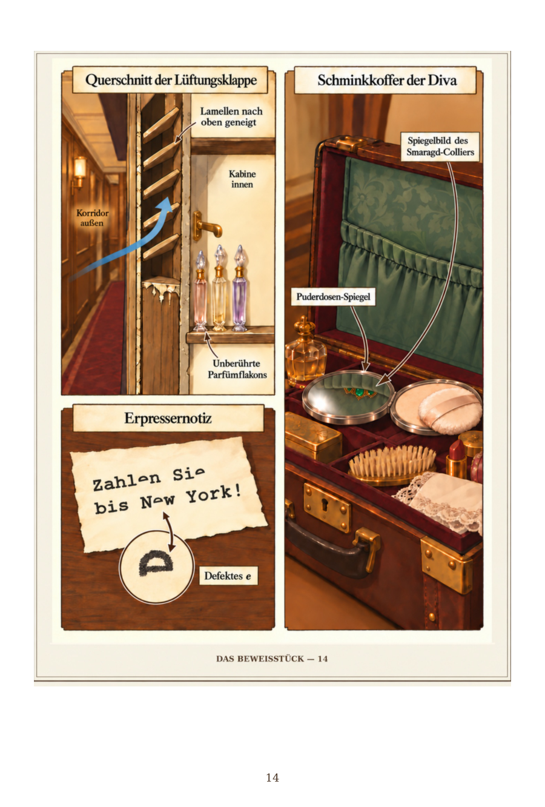
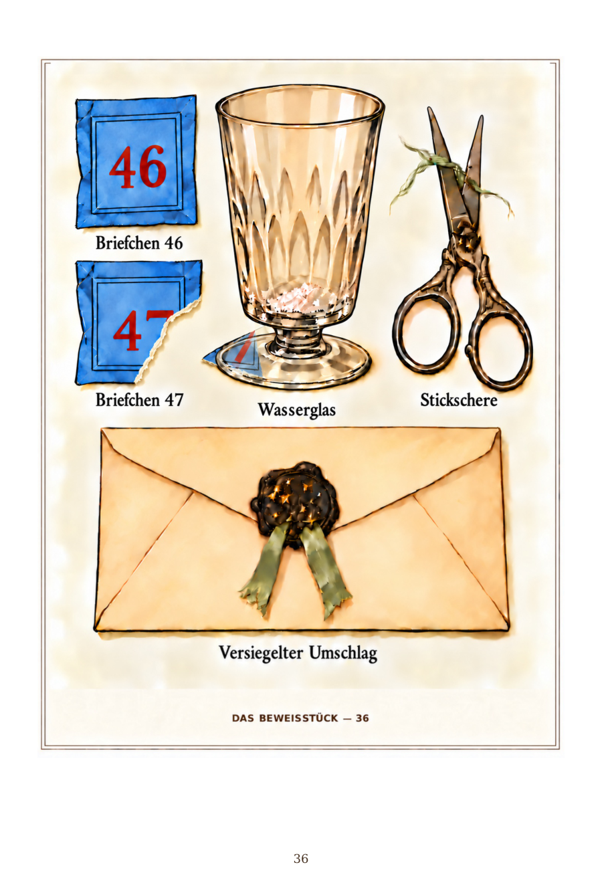
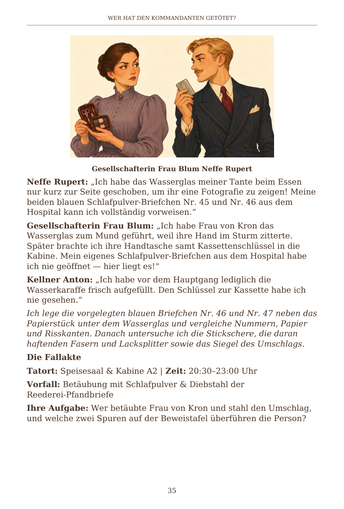
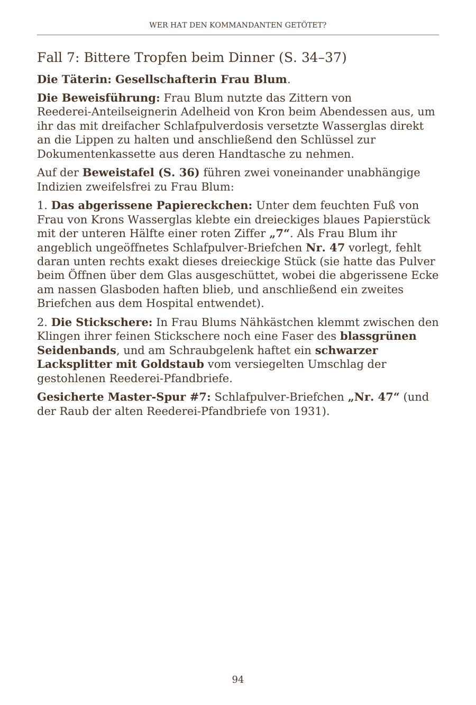
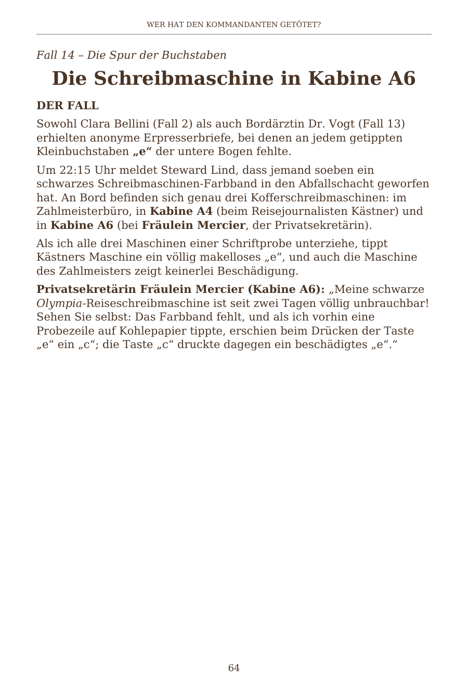

# V8 verified pages

[Open the v8 PDF](Wer_hat_den_Kommandanten_getoetet_Corrected_v8.pdf) and click **Download raw file**.

PDF SHA-256: `f10dd6632085dc0db74c125485cfc3a14843030a6510dfe6e4462bc32ce28b1b`

This export removes 293 obsolete empty text blocks that referenced removed fonts. Full-document Poppler validation now returns zero warnings/errors. All 47 required text phrases pass in three readers (141 checks). Page 5 and pages 101-104 remain unchanged.

## Page 4

Original v3 two-part blueprint, restored as a plain RGB image object.

## Page 30

Four separate complete images in a nonoverlapping 2x2 grid.

## Page 14

Corrected mirror illustration: necklace visible only in the reflection.

## Page 36

The lower stem of 7 is missing from packet 47 and appears on the scrap.

## Page 35

Top-left area is clear; the text reads normally.

## Page 94

Literal German quotation marks around 7; no raw LaTeX.

## Page 64

Opening quotes and the damaged-e ending are preserved.

## Page 30 panel files

[v8_panel_01](v8_panel_01.png)

[v8_panel_02](v8_panel_02.png)

[v8_panel_03](v8_panel_03.png)

[v8_panel_04](v8_panel_04.png)

