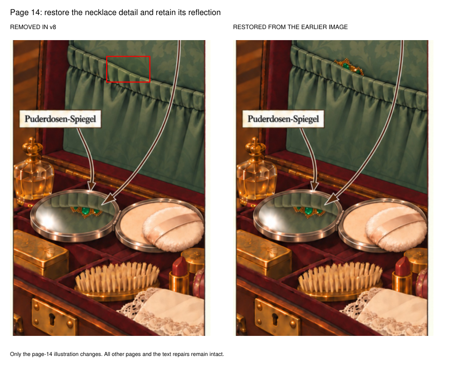
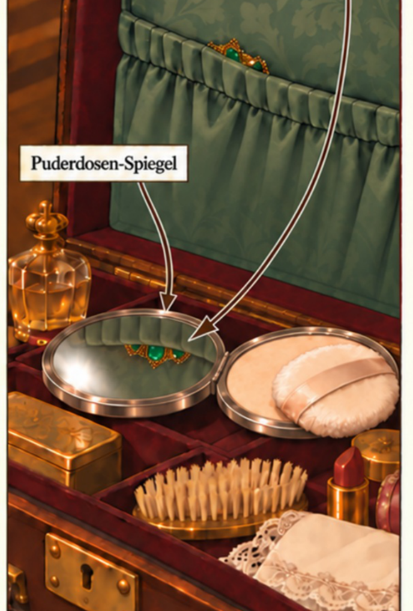
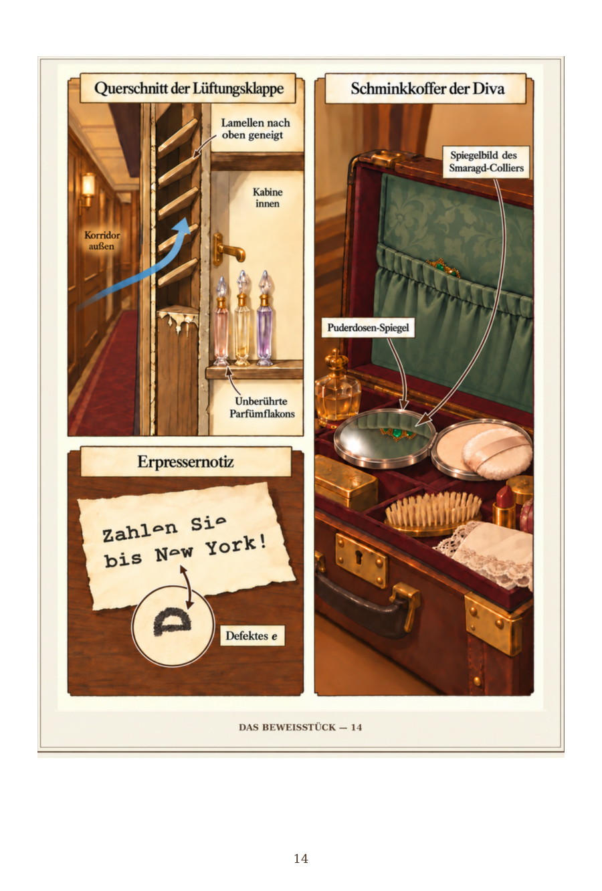

# V9: necklace detail restored

[Open the v9 PDF](Wer_hat_den_Kommandanten_getoetet_Corrected_v9.pdf) and click **Download raw file**.

The visible necklace edge has been restored from the earlier illustration. Its powder-mirror reflection remains. This undoes the erroneous removal. Only page 14 changes; the other 103 pages and all native text are unchanged.

PDF SHA-256: `1ea72a262a5e5cc0d9e2164a1214f726ab7199641ded00812dd20517ecd501ec`

## Before and after

## Restored detail

## Complete restored page 14

